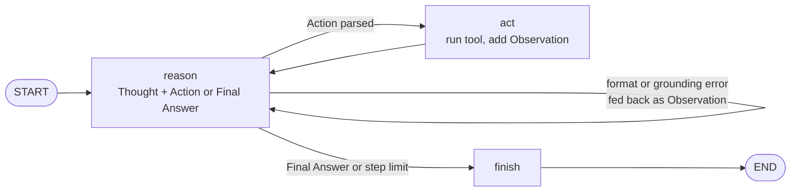

# Cedar Trails: a ReAct hiking planner with configurable personas

**EECE 503P/798S Agentic Systems, Assignment: Agent Personas & Thinking Mechanisms**

Cedar Trails plans hikes on the **Lebanon Mountain Trail**. It is a **ReAct agent implemented by hand in LangGraph**: explicit
`reason`, `act` and `finish` nodes with conditional edges, a text `Thought / Action / Observation` protocol, our own action
parser, and no prebuilt agent executor. Three personas share the loop, each with its own task, prompt traits and LLM configuration.

| Persona | Task | Prompt traits | LLM config |
|---|---|---|---|
| **Rami**, Friendly Trail Buddy | route inspiration | warm, vivid, encouraging | temp 0.8, top_p 0.95, top_k 64, presence 0.4 |
| **Hala**, Strict Safety Ranger | go / no-go assessment | firm, precise, verdict first | temp 0.1, top_p 0.5, top_k 10 |
| **Nour**, Gear Quartermaster | packing list | practical, quantities, dry humour | temp 0.3, top_p 0.8, frequency 0.5 |

## The ReAct loop



Tools: `search_trail_sections`, `get_section_details`, `estimate_hike_time` (Naismith's rule), `get_season_conditions`,
`check_safety_alerts`, `build_packing_list`. The trail data is a simplified, illustrative dataset; alerts are simulated.

## Key results (128 runs, see the notebook for tables and charts)

| Finding | Evidence |
|---|---|
| Model choice matters most | E1 quality: Qwen3.8-27B 0.88, GPT-OSS-20B 0.78, Gemini 3.5 flash-lite 0.53, GPT-OSS-120B 0.33 |
| The instructions block is essential | E5a: quality 0.88 vs 0.58 without it; format compliance 83% vs 0% |
| Instructions belong in the system prompt | E3: 0.70 vs 0.44 in the user message |
| Temperature trades diversity for stability | E4: diversity 0.39 at 0.0 to 0.72 at 1.2 with quality about 1.0; collapse at 1.6 (0.21) |
| Most helpful persona | Nour (judge helpfulness 4.36, persona fit 3.95) |

The full answers to the reflection questions are in [REFLECTION.md](REFLECTION.md) and in section 11 of the notebook.

## Repository

```
cedar_trails/
├── cedar_trails.ipynb    # main deliverable: use case, code, experiments, charts, reflection
├── cedar_trails.py       # agent code (the notebook cells are generated from its sections)
├── experiments.py        # experiment runner (resumable) + LLM judge
├── build_notebook.py     # rebuilds the notebook from cedar_trails.py
├── smoke_test.py         # one question per persona, prints the ReAct trace
├── data/trail_data.json  # illustrative LMT sections, seasons and simulated alerts
├── results/              # experiment logs (runs, judge scores, discarded first pass)
├── REFLECTION.md
├── requirements.txt
└── .env.example
```

## Run it

```bash
pip install -r requirements.txt
cp .env.example .env      # add GROQ_API_KEY and GEMINI_API_KEY (both free)
python smoke_test.py      # quick check of all three personas
python cedar_trails.py    # Gradio app with persona and model selection and a live trace panel
jupyter notebook cedar_trails.ipynb
```

Re-running experiments: `python experiments.py --dry-run`, then `python experiments.py`, then `python experiments.py --judge`.
